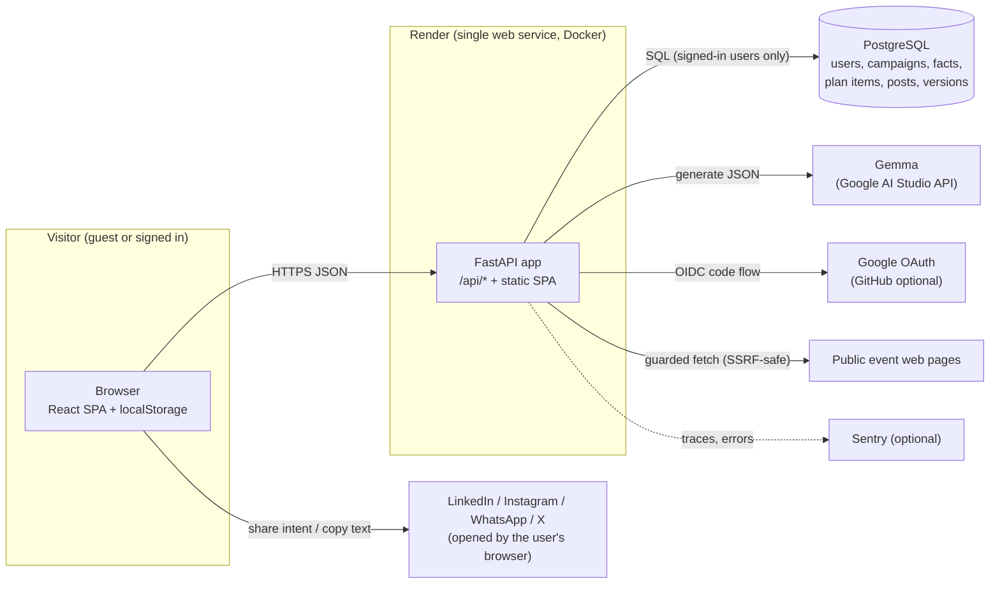
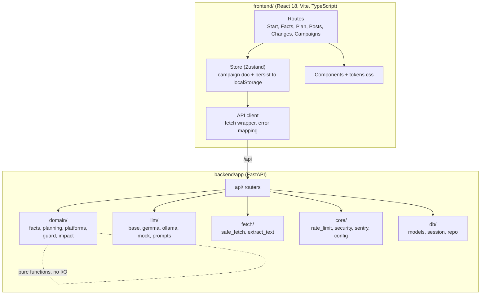
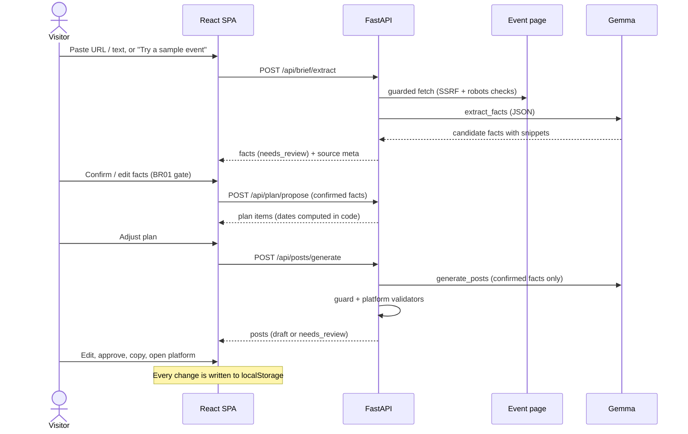
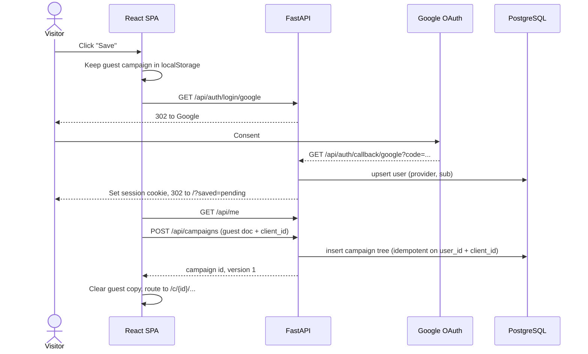
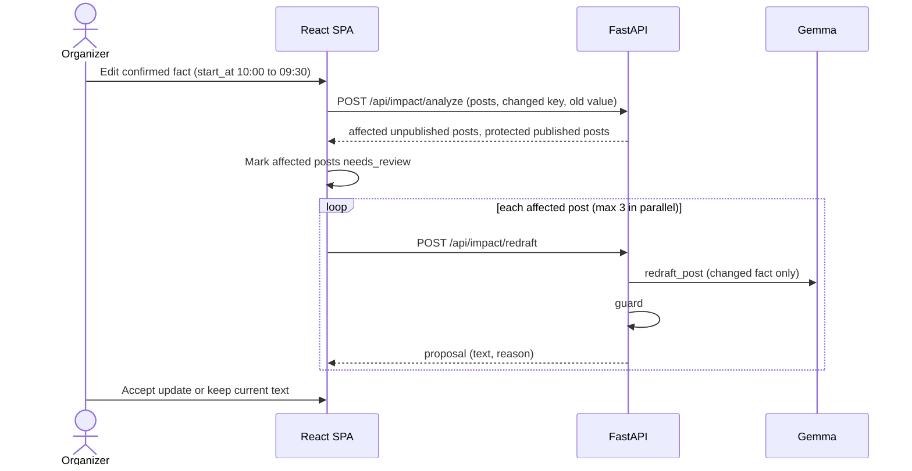
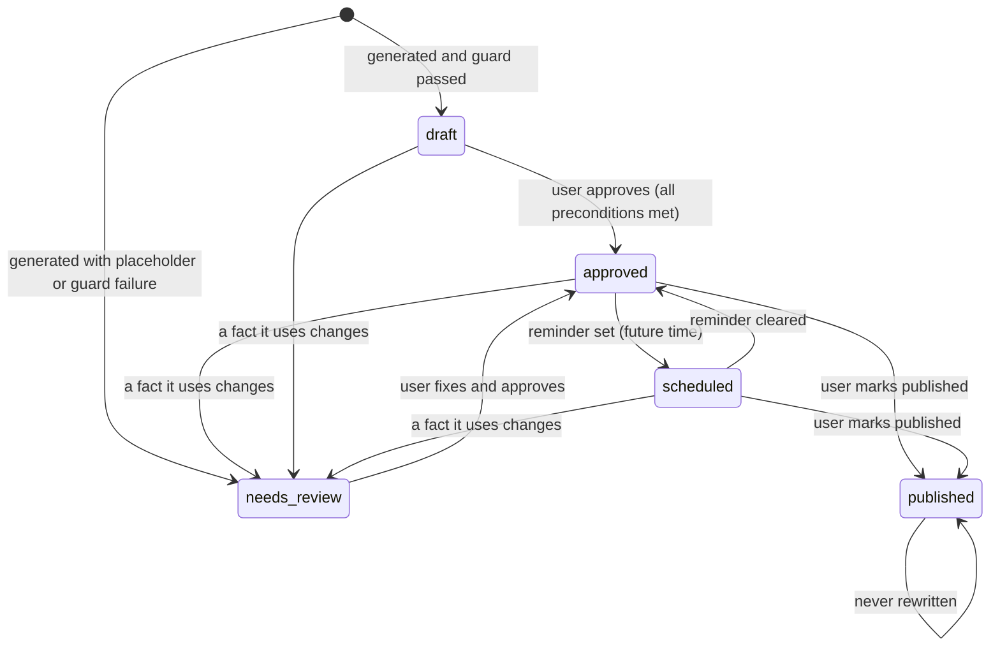
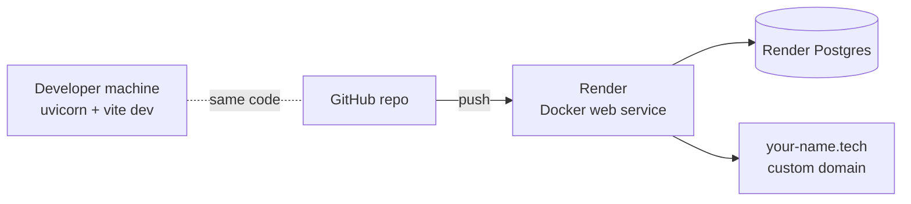

# Campaory: Architecture

Version 1.1, 16 Oct 2026. Diagrams are Mermaid. In VS Code install "Markdown Preview Mermaid Support". Diagrams were not rendered or syntax-checked offline; fix any that fail to render.

## 1. System context

Key points:
- Guests never touch the database. The guest campaign lives in the browser; the API is stateless for guests.
- The user's browser opens the social platforms. Campaory never posts on the user's behalf.
- One deployable unit: FastAPI serves both `/api/*` and the built React app.

## 2. Containers and modules

Rules of the road:
- `domain/` has no I/O and no framework imports. Everything deterministic and testable lives there.
- `llm/` is the only place that knows a model exists. The rest of the code calls `LLMProvider.generate_json`.
- The LLM never decides dates, limits, links or statuses. See ADR-005.

## 3. Guest workflow (no account)

## 4. Sign in and save

## 5. Change impact

## 6. Post status machine

## 7. Deployment

The Dockerfile builds the frontend in a Node stage and copies `frontend/dist` into the Python image. See `render.yaml`.

## 8. Quality attributes

| Attribute | How the architecture delivers it |
|---|---|
| Trust in facts | Confirmed-facts-only prompts, deterministic guard, BR01/BR02 gates |
| Privacy | Guest data never stored server-side; saved data only after sign-in; delete account |
| Cost control | Rate limits per IP and user, daily cap, mock fallback |
| Replaceable model | `LLMProvider` adapter, provider chosen by env |
| Simplicity | One service, one database, no queue, no worker |
| Testability | Pure domain functions, mock provider, stateless guest endpoints |

Known limits: the rate limiter is in memory, so it assumes one instance. Scaling to several instances needs a shared store (see HLD section 9).
